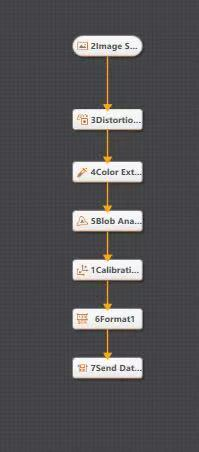
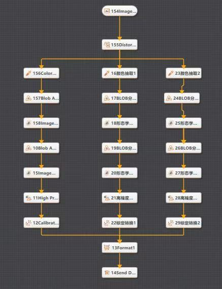

# 电池视觉定位与抓放流程说明

美团挑战赛机器人代码说明 02 | 中文版 | 2026 年 10 月 13 日

## 1 文档概述

`battery.docx` 中的 `Battery` 模块实现视觉引导的电池抓取与放置：先尝试获取蓝、绿、黄三组坐标，满足多目标条件时按黄色、绿色、蓝色的顺序抓放；否则请求红色目标并执行单电池任务。该模块连接主程序调度、VisionMaster 视觉结果和机器人运动，是当前提供代码中的作业主体。

这里的任务一/任务二是当前工程的单红色目标/三色目标流程标签。它们不等于整场赛事的完整换电作业；当前代码中没有可确认的电连接检测、机械锁止确认或换电完成验收逻辑。

## 2 过程分工

| 过程 | 输入与依赖 | 主要行为 |
| --- | --- | --- |
| Battery_get_values | input_string、拍照参考点、通信模块 | 请求视觉结果，检查结果并加入位置补偿 |
| Battery_work | 六个解析值、回复字符串 | 先判断多目标，再回退到红色目标 |
| Battery_work_1 | nval1、nval2、红色放置点 | 单红色电池抓放 |
| Battery_work_2 | 三组坐标、三色放置点 | 黄色、绿色、蓝色依次抓放 |

## 3 获取坐标与选择任务

`Battery_get_values` 先移动至 `Redy_Camara_Diamonds` 并等待到位，将 `input_string` 复制到 `send_string`，设置 `socket_start = TRUE`、`startPLC = FALSE`，等待 0.1 秒后调用 `Connect2`。视觉回复由通信模块解析到 `nval1` 至 `nval6`。

如果前两个数值同时为零，或回复字符串等于 `",;"`，过程打印错误/无目标提示并返回；否则对三组 X/Y 数值分别加上 `diamondX`、`diamondY`，再移动到拍照参考点。此处 `RETURN` 只退出当前过程，并没有向调用方返回独立的成功布尔值。

`Battery_work` 的现有执行顺序为：

1. 设置 `input_string = "Getvalues"` 并获取坐标。
2. 当第五、六个值不同时等于各自公共补偿值，且第一组不同时为零、回复不等于 `",;"` 时，进入 `Battery_work_2`，完成后退出本轮作业。
3. 条件不满足时改为 `"Redvalues"`，重新获取坐标并进行无目标判断。
4. 检测到红色坐标后调用 `Battery_work_1`。当前代码随后还有第二次 `"Redvalues"` 请求与判断；若这次仍检测到目标，会再次调用 `Battery_work_1`。

因此，当前单红色分支并非固定“每轮只抓一次”；第二次请求不是异常重试的专用分支。说明文档保留此行为，具体是否符合现场任务意图需要由队伍核对。

## 4 坐标映射与抓放顺序

| 分支 | 坐标字段 | 执行顺序 | 实际 MoveL 使用的放置点 |
| --- | --- | --- | --- |
| 单红色目标 | nval1、nval2 | 红色 | D_put_Red |
| 三色目标 | nval5、nval6 | 第一个：黄色 | D_put_Yellow |
| 三色目标 | nval3、nval4 | 第二个：绿色 | D_put_Green |
| 三色目标 | nval1、nval2 | 第三个：蓝色 | D_put_Blue |

三色数据字段按蓝、绿、黄组织，执行顺序则是黄、绿、蓝。黄色和蓝色段落的部分注释与日志写了“放到对方颜色位置”，但实际运动指令分别使用 `D_put_Yellow`、`D_put_Blue`；应以上表中的执行语句为准，物理工位含义需与现场示教结果核对。

每个有效目标遵循相似的抓放过程：根据视觉 X/Y、拍照参考点和颜色专用经验补偿计算偏移；从接近位置分段下降；通过 `Set IIO_do2` 发出抓取输出；抬升并移动至放置点；通过 `ReSet IIO_do2` 释放；离开放置区域。三色分支全部处理后回到拍照参考点，单色分支也在放置后回到该点。

代码使用 `MoveL`、`RelTool`、`Offs`、`WaitRob` 和 `WaitTime` 组织这些动作。`offSetAngle` 在现有抓放过程中固定为零，不能将解析出的第三个值描述为已参与姿态调整。抓取输出的具体机械装置类型及反馈检测不在材料中。

## 5 VisionMaster 视觉流程

### 5.1 Task 1 单目标流程

图中可辨识的串行节点包含图像来源、畸变处理、颜色提取、Blob 分析、标定、格式化与发送数据。机器人侧单红色分支使用 `Redvalues` 请求。视觉工程的触发绑定、颜色阈值、Blob 筛选参数及输出模板需要在原 VisionMaster 工程中核对。

### 5.2 Task 2 多目标流程

图中图像与畸变处理之后展开三条颜色处理分支，各分支包含 Blob、图像或形态学处理以及标定/坐标转换相关节点，最后汇入 `Format1` 和数据发送节点。机器人侧 `Getvalues` 请求对应三组数值的消费路径。

两张图是流程截图，不包含可读取的完整配置。图中文字有截断，不能仅凭截图确认每条视觉分支的精确颜色绑定、标定矩阵、输出单位或算法参数。

## 6 边界与核对事项

- **有效性检查并不完整。** `StrToVal` 的转换结果没有形成上层统一成功标志；坐标补偿发生在部分判空之后，补偿后的零值判断不能独立证明原始目标有效。
- **三色目标共用一次坐标获取。** 当前过程未在每次抓取前重新拍照；运行期间目标位置变化的处理需要现场评估。
- **网络异常与旧值。** 解析时会重置六个数值，但在到达解析过程前发生通信错误，旧数值是否还可能参与本轮逻辑需要验证。
- **输出不等于抓取成功。** 设置数字输出和固定等待没有证明工件被抓住或放稳；材料中未见对应传感器确认。
- **运动参数依赖工作站。** 不将原文件中的标定坐标、颜色补偿和运动参数当作通用可直接运行配置。

这些事项属于当前说明的适用边界，不代表本次已修改代码。程序尚未在本轮进行编译、仿真或真机执行。

## 7 源码定位

源版本：`lkkkkk667/meituan`，提交 `68e262bbedcf2269ba3a7321a045f97e96f185b6`。

- `battery.docx`：`Battery_get_values`、`Battery_work`、`Battery_work_1`、`Battery_work_2`。
- `connect_socket.docx`：`ProcessReceivedData` 中六个字段的解析与复位。
- `Modul.docx`：共享变量、拍照参考点及各颜色放置点。
- `task1.jpg`、`task2.jpg`：原始 VisionMaster 流程截图。

配套说明：[主程序](01-main-program.md) · [通信模块](03-socket-communication.md)。
